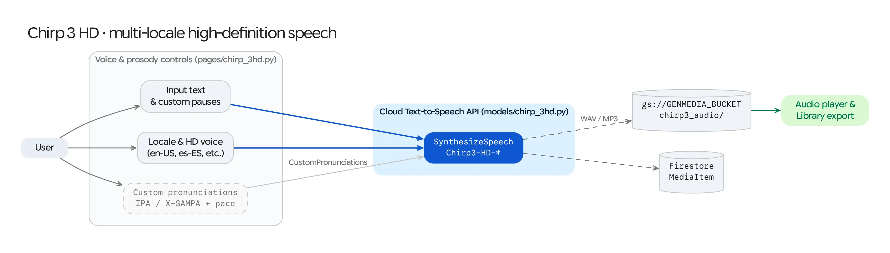

The **Chirp 3 HD** workspace (`/chirp-3hd`) provides a dedicated studio for Google Cloud's **Chirp 3 HD Voices** via the Cloud Text-to-Speech API (`google.cloud.texttospeech_v1beta1`), designed for enterprise narration, localization across 30+ languages, and exact phonetic pronunciation overrides.

## Source Architecture

| Layer | File Path | Responsibility |
| :--- | :--- | :--- |
| **Mesop Page & State** | `pages/chirp_3hd.py` (`Chirp3hdState`) | Voice & locale selector, speaking rate slider, pause insertion helpers, custom pronunciation editor (`IPA` / `X-SAMPA`), and Gemini AI script generator. |
| **Model Adapter** | `models/chirp_3hd.py` (`synthesize_chirp_speech`, `list_chirp_voices`) | Calls `TextToSpeechClient.synthesize_speech()` with `VoiceSelectionParams`, `AudioConfig`, and `CustomPronunciations`, returning WAV bytes. |

## Key Capabilities & Controls

### 1. Dynamic Multi-Locale HD Voice Discovery
* On workspace initialization, `list_chirp_voices()` queries `TextToSpeechClient.list_voices()` and filters for `Chirp3-HD` voice profiles (`en-US-Chirp3-HD-Kore`, `es-ES-Chirp3-HD-Aoede`, `ja-JP-Chirp3-HD-Fenrir`, etc.).
* Users can filter voices by **Language / Locale (`BCP-47`)** and **Voice Persona** (`Aoede`, `Charon`, `Fenrir`, `Kore`, `Leda`, `Orus`, `Puck`, `Zephyr`).

### 2. Speaking Rate & Pause Controls
* **Speaking Rate (`speaking_rate`):** Adjustable from `0.25x` to `2.0x` normal cadence via `texttospeech.AudioConfig(audio_encoding=LINEAR16, speaking_rate=...)`.
* **Pause Helpers:** Quick-insert controls for natural pauses and punctuation pacing within long-form scripts.

### 3. Custom Phonetic Pronunciations (`IPA` & `X-SAMPA`)
For brand names, medical terminology, or regional proper nouns, users can define multiple **Custom Pronunciation Rules** (`CustomPronunciationEntry`):
* **Phrase:** The exact substring in the input text to override.
* **Phonetic Encoding:** Either **International Phonetic Alphabet (`PHONETIC_ENCODING_IPA`)** or **Extended Speech Assessment Methods Phonetic Alphabet (`PHONETIC_ENCODING_X_SAMPA`)**.
* **Phonetic String:** Passed to the Cloud TTS API via `SynthesisInput.custom_pronunciations`.

### 4. Integrated Acoustic Analysis & Library Persistence
* Synthesized `LINEAR16` WAV audio is persisted to `gs://<GENMEDIA_BUCKET>` via `store_to_gcs()`, logged as a `MediaItem` in Firestore, and optionally analyzed with `models/audio_analysis.py` for pitch contour and voice quality inspection.
