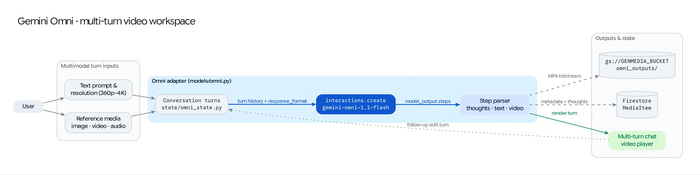

The **Gemini Omni** workspace (`/gemini-omni`) provides a unified canvas for **interleaved multimodal generation** using `gemini-omni-1.1-flash-preview`. Unlike single-modality endpoints, Gemini Omni accepts mixed combinations of text, reference images, and audio inputs and produces interleaved responses containing rich markdown text, synthesized images, and audio outputs in a single turn.

## Source Architecture

| Layer | File Path | Responsibility |
| :--- | :--- | :--- |
| **Mesop Page & State** | `pages/omni.py` (`OmniPageState`) | Interactive workspace UI, multimodal uploaders (images & audio), resolution selector, and interleaved output renderer. |
| **Model Adapter** | `models/omni.py` (`generate_omni_content`) | Translates multimodal inputs into Vertex AI Interactions API payloads (`client.interactions.create`), streams or unpacks interleaved output turns, and uploads generated media to GCS. |
| **Configuration** | `config/default.py` | Configures the Interactions API client (`api_version="v1beta1"`) and default GCS bucket (`GENMEDIA_BUCKET`). |

## Key Capabilities & Controls

### 1. Multimodal Reference Inputs
Users can combine a natural-language prompt with multiple reference assets uploaded from disk or selected from the Studio Library:
* **Image Inputs:** Up to multiple reference images (`image/png`, `image/jpeg`, `image/webp`) converted from `gs://` URIs and passed as inline byte payloads (`{"type": "image", "data": ..., "mime_type": ...}`).
* **Audio Inputs:** Reference voice or audio clips (`audio/wav`, `audio/mpeg`, `audio/mp3`) passed as `{"type": "audio", "data": ..., "mime_type": ...}` for audio-conditioned reasoning or response synthesis.

### 2. Output Resolution Selector (`360p` to `4k`)
When generating visual assets within an interleaved turn, the workspace exposes an output resolution selector in `OmniPageState.resolution`:
* Supported tiers: `360p`, `720p`, `1080p` (default), and `4k`.
* Passed via `generation_config={"image_config": {"image_size": resolution}}` inside `client.interactions.create()`.

### 3. Thought Summaries (`thought` Turns)
Gemini Omni exposes intermediate reasoning steps before emitting its final interleaved media:
* Any output block marked with `output.type == "thought"` or `getattr(output, "thought", False)` is captured into `thought_text` and displayed in a collapsible **Model Thoughts** accordion in the UI so users can inspect how the model planned its visual and textual layout.

## Request Lifecycle (`models/omni.py`)

1. **Client Initialization:** `get_omni_client()` initializes a `genai.Client(vertexai=True, project=cfg.PROJECT_ID, location="global", http_options=HttpOptions(api_version="v1beta1"))`.
2. **Input Assembly:** `generate_omni_content()` downloads any referenced `gs://` images or audio clips into memory, base64-encodes the binary payloads, and appends the user's text prompt to the `inputs` list.
3. **Interactions API Call:** Invokes `client.interactions.create(model="gemini-omni-1.1-flash-preview", input=inputs, response_modalities=["text", "image"], generation_config=...)` inside `track_model_call()`.
4. **Interleaved Output Parsing & Persistence:**
   * `text` blocks are appended in order (`{"type": "text", "text": ...}`).
   * `image` and `audio` blocks are decoded from base64, uploaded to `gs://<GENMEDIA_BUCKET>/omni_outputs/` via `store_to_gcs()`, and returned as ordered items in `outputs`.
   * The complete interleaved sequence (`outputs` JSON, `thought_text`, input references, and generation duration) is persisted as a single `MediaItem` (`media_type="omni"`) in Firestore so the entire multimodal turn can be replayed from the Studio Library.
