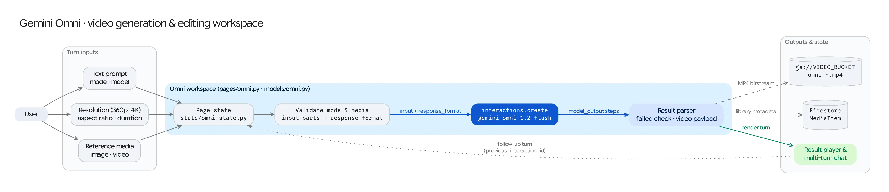

The **Gemini Omni** workspace (`/gemini-omni`) is a video generation and editing studio built on the Vertex AI **Interactions API**. It defaults to `gemini-omni-1.2-flash`; Gemini Omni 1.1 (`gemini-omni-1.1-flash-preview`) stays selectable from the model dropdown. One page covers seven modes, and every result can be refined in a multi-turn chat thread.

## Modes

The mode list is model-aware (`modes_for_model()` in `config/omni_models.py`):

| Mode | Inputs | Notes |
| :--- | :--- | :--- |
| Text to video (`t2v`) | Prompt | |
| Image to video (`i2v`) | Prompt + one image | The image is required. |
| First/Last frame (`first_last`) | Prompt + first image + last image | Both images are required (1.2 and 1.1 only). They are sent in order: the first image is the first frame and the second is the last frame. Sends `video_config.task="image_to_video"`. |
| Reference to video (`ref2v`) | Prompt + reference images | At least one image is required. The page accepts up to 3 (`MAX_R2V_REFERENCES`). |
| Edit video (`edit`) | Prompt + video | A base video is required. Output length matches the input video. |
| Extend video (`extend`) | Prompt + video | 1.2 only. Sends `generation_config.video_config.task="extend"`. Output is the input plus a fixed extra span. |
| Upscale video (`upscale`) | Video only | 1.2 only. Sends `video_config.task="upscale"` and **no text part** (the API rejects text for this task). Output is `1080p` or `4k`. Terminal: no chat follow-up. |

Only `first_last`, `extend` and `upscale` send an explicit task (`OMNI_TASK_BY_MODE` / `EXPLICIT_TASK_MODES`: `image_to_video`, `extend` and `upscale`). For every other mode the model infers the task from the inputs.

The Interactions API has no dedicated first/last-frame task (`first_last_frame` is rejected with a 400). A live probe (`scripts/spikes/omni_first_last_probe.py`) showed that two images supplied in order are honored as the first and last frame on both 1.2 and 1.1, with or without "first frame / last frame" wording in the prompt, and that an explicit `image_to_video` task behaves identically to the inferred one. An explicit `reference_to_video` task with two images does not: it treats them as references instead. Media inputs are validated before any billable call by `find_missing_required_media()`, which also disables the **Generate Video** button.

## Controls

| Control | Values | Notes |
| :--- | :--- | :--- |
| Model | 1.2 Flash (default), 1.1 Flash (Preview) | Switching model keeps the current mode and duration if the new model supports them; otherwise it falls back to `t2v` and clamps the duration (`clamp_duration()`). |
| Resolution | `360p`, `720p` (default), `1080p`, `4k` | Always sent. For upscale it is the target resolution. |
| Aspect ratio | `16:9`, `9:16` | Disabled for `extend` and `upscale` (the framing follows the input video). |
| Duration | 3–15 s on 1.2, 3–10 s on 1.1 | Disabled for `extend`, hidden for `upscale` (the length follows the input video). |

Once a conversation has started, all generation settings are locked so the thread stays consistent. Use **Reset Chat** to change them.

## Source Architecture

| Layer | File Path | Responsibility |
| :--- | :--- | :--- |
| **Mesop page** | `pages/omni.py` | Workspace UI: mode, model and settings panel, media uploaders, result player, and the chat thread (`on_send_chat_turn`, `on_reset_chat`). |
| **Page state** | `state/omni_state.py` (`PageState`) | Mode, model, resolution, aspect ratio, duration, reference media, `previous_interaction_id`, and the chat history as JSON strings (`chat_history_json`, `chat_messages_json`). |
| **Model adapter** | `models/omni.py` | `generate_omni_video()`, `get_omni_client()`, `_build_input_parts()`, `_build_video_response_format()`, `_extract_video_payload()`, `_save_video_to_gcs()`. |
| **Model registry** | `config/omni_models.py` | `OMNI_MODELS` is the single source of truth for each model's modes, aspect ratios, resolutions and duration range. The UI builds its dropdowns from it. |
| **Request contract** | `models/requests.py` (`OmniVideoGenerationRequest`) | Prompt, duration, aspect ratio, resolution, mode, model, reference media URIs, and multi-turn context. |
| **Configuration** | `config/default.py` | `OMNI_MODEL_ID`, `DEFAULT_OMNI_MODEL_NAME`, `OMNI_PROJECT_ID`, `OMNI_LOCATION`, `OMNI_TIMEOUT_MS`. |

## Request Lifecycle

`generate_omni_video()` runs synchronously inside `track_model_call()`:

1. **Validate.** The model must exist in the registry and support the requested mode, and the mode's required media must be present (`MissingMediaError`, `GenerationError` with `INVALID_ARGUMENT`).
2. **Client.** `get_omni_client()` returns a cached `genai.Client(enterprise=True, project=OMNI_PROJECT_ID, location=OMNI_LOCATION)` (default `global`) with an `OMNI_TIMEOUT_MS` timeout (default 10 minutes).
3. **Input.** `_build_input_parts()` builds the input list: the prompt (omitted for upscale) followed by the mode's media as `gs://` URI parts. Multi-turn requests instead replay `chat_history_json` and append the new prompt.
4. **Output format.** `_build_video_response_format()` sends `resolution` for every mode. For text, image, reference and multi-turn requests it also sends `aspect_ratio` and `duration` (as `"<N>s"`). Edit, extend and upscale send resolution only, because their framing and length come from the input video (an edit with a mismatched duration is rejected with a 400). Aspect ratio and duration are never written into the prompt text.
5. **Call.** `client.interactions.create(model=..., input=..., response_format=[...], previous_interaction_id=..., generation_config=...)`. `generation_config` carries `video_config.task` only for extend and upscale.
6. **Extract.** `_extract_video_payload()` first raises a `GenerationError` for failed interactions (`failed`, `cancelled`, `incomplete` or `budget_exceeded`) using the API's `errors` detail. Otherwise it reads the video from the `model_output` steps. `errors` on a completed interaction is diagnostic only.
7. **Persist.** `_save_video_to_gcs()` decodes the MP4 and uploads it with `store_to_gcs()`. The page then records a `MediaItem` (`mime_type="video/mp4"`, with the prompt, aspect ratio, resolution and model) via `add_media_item_to_firestore()`, so every result appears in the Studio Library.

Errors surface as `GenerationError` and are shown in the page's error dialog.

## Multi-turn Chat Thread

After a non-upscale generation the page keeps the returned interaction ID in `previous_interaction_id` and the turn history in `chat_history_json`. Each follow-up (**Send**) calls the same `generate_omni_video()` with `previous_interaction_id` set; earlier model videos are re-read from GCS and resent as base64 (`_resolve_gcs_uris_in_history()`). Per-mode media requirements do not apply to follow-up turns. **Upscale** is terminal: it produces a library item but starts no thread.

## Configuration

| Variable | Default | Purpose |
| :--- | :--- | :--- |
| `DEFAULT_OMNI_MODEL_NAME` | `gemini-omni-1.2-flash` | Model preselected on the page (resolved through the registry). |
| `OMNI_MODEL_ID` | `gemini-omni-1.2-flash` | Defined in config but not read by the page; the preselected model comes from `DEFAULT_OMNI_MODEL_NAME`. |
| `OMNI_PROJECT_ID` | `PROJECT_ID` | Project that owns the Omni quota and billing. |
| `OMNI_LOCATION` | `global` | Omni is served from the `global` endpoint. |
| `OMNI_TIMEOUT_MS` | `600000` | Client and request timeout. |

To add a new Omni model version, add an `OmniModelConfig` entry to `OMNI_MODELS` in `config/omni_models.py`; the mode, resolution and duration controls follow automatically.
