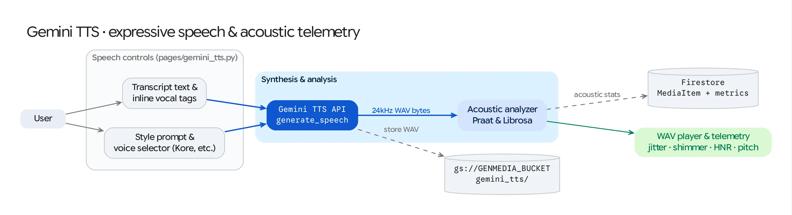

The **Gemini TTS** workspace (`/gemini-tts`) enables expressive voice acting, multi-speaker dialogue synthesis, and objective acoustic quality analysis using the Vertex AI Gemini TTS model family (`gemini-3.8-flash-tts`, `gemini-3.8-flash-lite-tts`, `gemini-2.5-flash-tts`, and `gemini-2.5-pro-tts`).

## Source Architecture

| Layer | File Path | Responsibility |
| :--- | :--- | :--- |
| **Mesop Page & State** | `pages/gemini_tts.py` (`GeminiTtsState`) | Single/multi-speaker voice director UI, natural-language style prompt input, voice & locale selectors, and acoustic telemetry dashboard. |
| **Model Adapter** | `models/gemini_tts.py` (`synthesize_speech`) | Invokes `client.models.generate_content()` with `response_modalities=["AUDIO"]` and `SpeechConfig` (`VoiceConfig` or `MultiSpeakerVoiceConfig`), converting raw 24 kHz PCM responses to WAV when needed. |
| **Acoustic Analyzer** | `models/audio_analysis.py` (`analyze_audio_bytes`) | Extracts pitch (`F0`), jitter, shimmer, Harmonics-to-Noise Ratio (`HNR`), tempo (`BPM`), and waveform/pitch-contour plots using **Librosa** and **Praat (`parselmouth`)**. |
| **Model & Voice Registry** | `config/gemini_tts.py` (`GEMINI_TTS_MODELS`, `GEMINI_TTS_VOICES`, `GEMINI_TTS_LOCALES`) | Declares the 30+ prebuilt voices (`Zephyr`, `Puck`, `Charon`, `Kore`, `Fenrir`, `Aoede`, etc.), supported BCP-47 locales, and model IDs. |

## Supported Models (`config/gemini_tts.py`)

| Display Name | Model ID | Primary Use Case |
| :--- | :--- | :--- |
| **Gemini 3.8 Flash TTS** | `gemini-3.8-flash-tts` | Flagship expressive voice acting, vocal bursts, inline emotional tags (`<sigh>`, `<gasp>`, `<whispers>`, `<short pause>`), and multi-speaker dialogue. |
| **Gemini 3.8 Flash Lite TTS** | `gemini-3.8-flash-lite-tts` | Low-latency batch synthesis and interactive voice agent responses. |
| **Gemini 2.5 Flash TTS** | `gemini-2.5-flash-tts` | Fast general-purpose single and multi-speaker synthesis. |
| **Gemini 2.5 Pro TTS** | `gemini-2.5-pro-tts` | High-fidelity long-form narration and complex prosody control. |

## Key Capabilities

### 1. Natural-Language Style Direction & Inline Vocal Tags
* **Style Prompt (`prompt`):** Users can direct the delivery tone, emotion, and pacing in natural language (e.g., *"Speak in a hushed, suspenseful whisper"* or *"Energetic sports commentator"*).
* **Inline Tags & Emphasis:** Supports expressive vocalizations (`<pant>`, `<gasp>`, `<sigh>`, `<whispers>`, `<short pause>`, `<long pause>`) and ALL-CAPS word stress.

### 2. Single-Speaker & Multi-Speaker Dialogue Modes
* **Single-Speaker Mode:** Configures `types.SpeechConfig(voice_config=types.VoiceConfig(prebuilt_voice_config=...))` with any of the 30+ prebuilt voices.
* **Multi-Speaker Mode:** Configures `types.MultiSpeakerVoiceConfig` mapping speaker aliases (e.g., `Speaker 1: Kore`, `Speaker 2: Puck`) directly to dialogue turns in the script.

### 3. Praat & Librosa Acoustic Telemetry (`models/audio_analysis.py`)
After every synthesis call, users can inspect objective voice quality and prosody metrics computed via **Librosa** and **Praat (`parselmouth`)**:
* **Prosody & Timing:** Duration (`seconds`), estimated speaking tempo (`BPM`), and mean/std Fundamental Frequency (`F0` pitch in `Hz`) with a visual pitch contour overlay.
* **Voice Quality Telemetry:**
  * **Local Jitter (`%`):** Cycle-to-cycle pitch period perturbation (vocal stability).
  * **Local Shimmer (`%`):** Cycle-to-cycle amplitude perturbation.
  * **Harmonics-to-Noise Ratio (`HNR` in `dB`):** Ratio of periodic harmonic energy to breathiness/noise.
