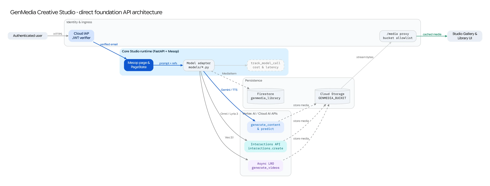

GenMedia Creative Studio provides dedicated, interactive workspaces for exploring Google Cloud's generative media foundation models directly. Before chaining models into multi-step creative pipelines, creators and engineers can use these direct workspaces to test prompts, compare model variants, inspect acoustic and visual telemetry, and curate reusable assets in the shared Studio Library.

## Direct Foundation Model Workspaces

| Workspace | Route | Primary Models (`config/`) | Key Capabilities |
| :--- | :--- | :--- | :--- |
| **[Gemini Omni](/genmedia-creative-studio/core/foundation-models/gemini-omni/)** | `/gemini-omni` | `gemini-omni-1.1-flash-preview` | Interleaved multimodal text, image, and audio generation via the Vertex AI Interactions API (`interactions.create`) with resolution controls (`360p`–`4k`) and thought summaries. |
| **[Veo](/genmedia-creative-studio/core/foundation-models/veo/)** | `/veo` | `veo-3.1-generate-001`, `veo-3.1-fast-generate-001`, `veo-3.1-lite-generate-001`, `veo-3.0-*`, `veo-2.0-*` | Asynchronous long-running operation (`generate_videos`) video synthesis across Text-to-Video (T2V), Image-to-Video (I2V), First/Last Frame Interpolation, Reference-to-Video (R2V), and Video Extension. |
| **[Gemini Image Generation (Nano Banana)](/genmedia-creative-studio/core/foundation-models/nano-banana/)** | `/nano-banana` | `gemini-3.1-flash-image-preview` (Nano Banana 2), `gemini-3.1-flash-image-lite-preview` (2 Lite), `gemini-3-pro-image-preview` (Pro), `gemini-2.5-flash-image` | Conversational image generation and multi-reference editing (`up to 14` reference images), `1K`/`2K`/`4K` output sizing, aspect ratio controls, and Google Search grounding. |
| **[Lyria](/genmedia-creative-studio/core/foundation-models/lyria/)** | `/lyria` | `lyria-002`, `lyria-3-clip-preview`, `lyria-3-pro-preview` | Instrumental and vocal music synthesis supporting text prompts, custom lyrics, image conditioning, and C2PA provenance metadata preservation. |
| **[Gemini TTS](/genmedia-creative-studio/core/foundation-models/gemini-tts/)** | `/gemini-tts` | `gemini-3.8-flash-tts`, `gemini-3.8-flash-lite-tts`, `gemini-2.5-flash-tts`, `gemini-2.5-pro-tts` | Expressive single- and multi-speaker speech synthesis with natural-language style direction, inline vocal tags, and integrated Praat/Librosa acoustic analysis. |
| **[Chirp 3 HD](/genmedia-creative-studio/core/foundation-models/chirp-3hd/)** | `/chirp-3hd` | `chirp_3` (`Cloud Text-to-Speech API v1beta1`) | High-definition multi-locale speech synthesis with speaking rate controls, custom pause insertions, and custom phonetic pronunciations (`IPA` / `X-SAMPA`). |
| **[Gemini Writers Workshop](/genmedia-creative-studio/core/foundation-models/writers-workshop/)** | `/gemini-writers-workshop` | `gemini-3.5-flash` / `gemini-3.5-pro` (`MODEL_ID`) | Multimodal prompt engineering and narrative ideation workspace with customizable system instructions and persistent Firestore `PromptTemplate` libraries. |

:::note[Imagen Deprecation Notice]
Legacy Imagen 3 and Imagen 4 workspaces (`/imagen`) are being deprecated across Vertex AI (beginning with `imagen-3.0-fast-generate-001` and `imagen-3.0-generate-002` shut downs, followed by Imagen 4 on June 24, 2026). All new image generation and editing workflows in GenMedia Creative Studio standardize on **[Gemini Image Generation (Nano Banana)](/genmedia-creative-studio/core/foundation-models/nano-banana/)**.
:::

---

## Shared Request & Persistence Lifecycle

Every direct foundation model workspace in the core application (`main.py`) shares a unified security, storage, and telemetry architecture:

### 1. Identity & Ingress (`main.py`)
* **Cloud IAP JWT Verification:** Incoming requests pass through `verify_iap_jwt()`, which validates the `X-Goog-IAP-JWT-Assertion` header against Google's public keys (`https://www.gstatic.com/iap/verify/public_key`) and binds the verified user identity (`user_email`) into `app.state` and Mesop `AppState`.
* **Forwarded Host & CSRF Middleware:** `TrustForwardedHostMiddleware` rewrites the internal `Host` header from `X-Forwarded-Host` so Mesop's WebSocket and `/__ui__` POST endpoints operate behind Cloud Run and Google Cloud Load Balancers without CSRF origin mismatches.

### 2. Mesop State & Model Adapters (`pages/*.py` → `models/*.py`)
* Each workspace maintains a page-scoped `@me.stateclass` (stored in `state/` or the page module) that binds UI controls—model selectors, aspect ratios, reference media uploaders, and advanced parameter drawers—directly to Python event generators.
* **Dynamic Model Capabilities:** Rather than hardcoding UI options, workspaces read declarative capability schemas from `config/` (`config/veo_models.py`, `config/gemini_image_models.py`, `config/lyria_models.py`, `config/gemini_tts.py`) to dynamically adapt available resolutions, durations, reference image limits, and grounding toggles whenever the user switches models.

### 3. Vertex AI & Cloud AI API Dispatch
Depending on the model family, adapters in `models/` invoke one of three primary Google Cloud API patterns via `google.genai.Client` or `google-cloud-texttospeech`:
1. **Unary `models.generate_content` / `models.predict`:** Used by Gemini Image Generation (Nano Banana), Gemini TTS, Gemini Writers Workshop, and Lyria 2 (`lyria-002`).
2. **Vertex AI Interactions API (`client.interactions.create`):** Used by Gemini Omni (`gemini-omni-1.1-flash-preview`) and Lyria 3 (`lyria-3-clip-preview`, `lyria-3-pro-preview`) for multimodal turn interactions and C2PA-signed media payloads.
3. **Asynchronous Long-Running Operations (`models.generate_videos`):** Used by Veo (`models/veo.py`) and the FastAPI `/api/veo/*` router (`routers/veo_router.py`), polling operation status until video bytes or GCS URIs are finalized.

### 4. Cloud Storage, `/media` Proxy, and Firestore Telemetry
* **Cloud Storage (`common/storage.py`):** Generated images, audio tracks, and video clips (as well as user-uploaded reference assets) are persisted to `gs://<GENMEDIA_BUCKET>` via `store_to_gcs()`.
* **Authenticated `/media/{bucket_name}/{object_path}` Proxy (`main.py`):** To render private GCS objects in the browser without exposing public bucket ACLs, FastAPI exposes a streaming `/media/` proxy that enforces a strict bucket allowlist (`GENMEDIA_BUCKET`, `VIDEO_BUCKET`, `IMAGE_BUCKET`, `MEDIA_BUCKET`) and returns immutable cache headers (`Cache-Control: public, max-age=3600`).
* **Firestore Metadata (`common/metadata.py`):** Every completed generation constructs a `MediaItem` dataclass and writes it to the Firestore `GENMEDIA_FIREBASE_DB` collection (`genmedia_library` by default) via `add_media_item_to_firestore()`. This powers the cross-app **Library** (`/library`), provenance inspection, and one-click "send to workflow" actions.
* **Cost & Latency Analytics (`common/analytics.py`):** Model calls are wrapped in the `track_model_call()` context manager, recording model name, token/unit parameters, latency, and estimated cost.
