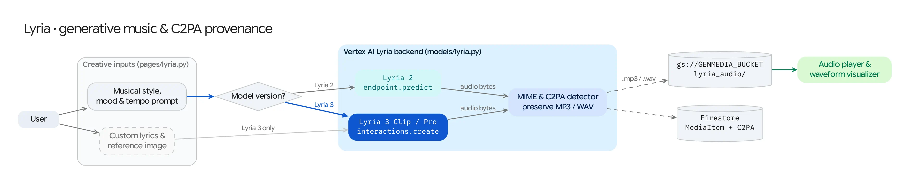

The **Lyria** workspace (`/lyria`) enables creators to generate original instrumental scores and full vocal music tracks using Google's **Lyria 2** (`lyria-002`) and **Lyria 3** (`lyria-3-clip-preview`, `lyria-3-pro-preview`) foundation models.

## Source Architecture

| Layer | File Path | Responsibility |
| :--- | :--- | :--- |
| **Mesop Page & State** | `pages/lyria.py` (`PageState`) | Model selector, prompt/negative-prompt/lyrics inputs, image-to-music uploader, audio player, and C2PA provenance badge. |
| **Model Adapter** | `models/lyria.py` (`generate_music_with_lyria`) | Dual-path dispatcher routing Lyria 2 to the Vertex AI Prediction endpoint (`aiplatform.gapic.PredictionServiceClient`) and Lyria 3 to the `google-genai` Interactions API (`client.interactions.create`). |
| **Model Registry** | `config/lyria_models.py` (`LYRIA_MODELS`, `LyriaModelConfig`) | Declares per-model capabilities (`supports_lyrics`, `supports_negative_prompt`, `supports_seed`, `supports_sample_count`, `supports_image_input`, `supports_c2pa`, and output `mime_type`). |

## Model Capabilities Matrix (`config/lyria_models.py`)

| Display Name | Model ID | API Backend | Output Format | Custom Lyrics | Image Conditioning | Negative Prompt / Seed / Batch | C2PA Provenance |
| :--- | :--- | :--- | :--- | :---: | :---: | :---: | :---: |
| **Lyria 2** | `lyria-002` | Vertex AI `predict` | `audio/wav` (30s) | No | No | Yes (`seed` or `sample_count` 1–4) | No |
| **Lyria 3 Clip (Preview)** | `lyria-3-clip-preview` | Interactions API (`v1beta1`) | `audio/mpeg` (30s MP3) | Yes | Yes | No | Yes |
| **Lyria 3 Pro (Preview)** | `lyria-3-pro-preview` | Interactions API (`v1beta1`) | `audio/mpeg` (Full-length MP3) | Yes | Yes | No | Yes |

## Dual-Engine Execution Flow (`models/lyria.py`)

### Path A: Lyria 2 (`lyria-002`) via Vertex AI `predict`
1. **Payload Assembly:** Combines `prompt`, optional `negative_prompt`, and either a deterministic `seed` or `sample_count` (mutually exclusive) into a protobuf `Value` instance.
2. **Prediction Call:** Invokes `PredictionServiceClient.predict()` against `projects/{PROJECT_ID}/locations/{LYRIA_LOCATION}/publishers/google/models/lyria-002`.
3. **Storage:** Decodes each base64 `bytesBase64Encoded` WAV prediction and uploads it to `gs://<MEDIA_BUCKET>` via `store_to_gcs()`.

### Path B: Lyria 3 (`lyria-3-clip-preview` & `lyria-3-pro-preview`) via Interactions API
1. **Multimodal & Lyrical Input Assembly:**
   * If the user provides **Custom Lyrics**, `models/lyria.py` formats the prompt with an explicit `Lyrics:\n...` block.
   * If the user uploads or selects a **Reference Image** (`image_uri`), the image is fetched from GCS and attached as an inline `{"type": "image", "data": ..., "mime_type": ...}` input part alongside the text prompt so Lyria 3 composes music matching the visual mood and aesthetic.
2. **Interactions API Invocation:** Calls `client.interactions.create(model=model_name, input=input_content, response_modalities=["audio", "text"])`.
3. **C2PA-Preserving MP3 Persistence & Metadata Extraction:**
   * Lyria 3 returns MP3 audio bytes with **embedded C2PA Content Credentials** (`c2pa.org` manifest store) alongside model-generated track metadata (`Title`, `Music Style`, `Detected Lyrics`) in the text modality.
   * **Important:** `models/lyria.py` writes the raw MP3 bytes directly to Cloud Storage without re-encoding or transcoding so the cryptographic C2PA signature remains intact, and extracts the manifest via `read_c2pa_manifest_bytes()` for display in the Studio UI.
