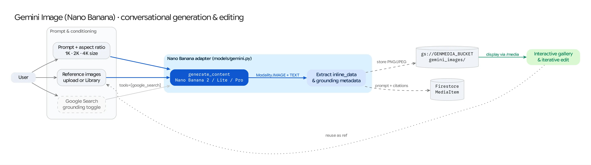

The **Gemini Image Generation (Nano Banana)** workspace (`/nano-banana`) provides a rich studio for text-to-image synthesis, multi-image reference conditioning, conversational image editing, and real-time **Google Search Grounding** using the Gemini native image generation family.

## Source Architecture

| Layer | File Path | Responsibility |
| :--- | :--- | :--- |
| **Mesop Page & State** | `pages/gemini_image_generation.py` (`GeminiImageGenState`) | Studio UI, multi-image reference uploader (`up to 14` images), aspect ratio & output size controls, Search Grounding toggle, and Quick Prompt presets. |
| **Model Adapter** | `models/gemini.py` (`generate_image_from_prompt_and_images`) | Builds multimodal `types.Part` contents, configures `ImageConfig` (`aspect_ratio`, `image_size`) and `ThinkingConfig`, invokes `client.models.generate_content()`, and stores generated PNGs to GCS. |
| **Model Registry** | `config/gemini_image_models.py` (`GEMINI_IMAGE_MODELS`) | Declarative capability specification (aspect ratios, output sizes `1K`/`2K`/`4K`, max reference images, and Search Grounding support) per Nano Banana variant. |
| **Prompt Presets** | `config/banana_presets.json` | Curated library of creative prompt templates and multi-image composition patterns. |

## Supported Models (`config/gemini_image_models.py`)

| Display Name | Model ID | Max Reference Images | Output Sizes (`image_size`) | Aspect Ratios | Search Grounding |
| :--- | :--- | :---: | :--- | :--- | :---: |
| **Gemini 3.1 Flash Image Preview (Nano Banana 2)** | `gemini-3.1-flash-image-preview` | **14** | `1K`, `2K`, `4K` | `1:1`, `3:2`, `2:3`, `3:4`, `4:3`, `4:5`, `5:4`, `9:16`, `16:9`, `21:9`, `1:4`, `4:1`, `1:8`, `8:1` | Yes |
| **Gemini 3.1 Flash Image Lite Preview (Nano Banana 2 Lite)** | `gemini-3.1-flash-image-lite-preview` | **14** | `1K`, `2K`, `4K` | All 14 ratios (`1:1` to `8:1`) | Yes |
| **Gemini 3 Pro Image Preview (Nano Banana Pro)** | `gemini-3-pro-image-preview` | **14** | `1K`, `2K`, `4K` | Standard 10 ratios (`1:1` to `21:9`) | Yes |
| **Gemini 2.5 Flash Image (Nano Banana)** | `gemini-2.5-flash-image` | **3** | `1K`, `2K` | Standard 10 ratios (`1:1` to `21:9`) | No |

## Key Capabilities

### 1. Multi-Image Reference Conditioning & Conversational Editing
* Users can upload up to **14 reference images** (with Nano Banana 2 / Pro) or select existing images from the Studio Library.
* Any generated image in the output gallery includes a **"Continue Editing"** action that promotes the generated image into the reference slot so users can iteratively refine lighting, outfits, backgrounds, or typography across turns.

### 2. Ultra-Wide & Panoramic Aspect Ratios + `4K` Sizing
* Nano Banana 2 (`gemini-3.1-flash-image-preview`) expands beyond standard photographic ratios to support extreme banner and vertical ratios (`1:4`, `4:1`, `1:8`, `8:1`) alongside native `1K`, `2K`, and `4K` output resolution settings (`types.ImageConfig(aspect_ratio=..., image_size=...)`).

### 3. Google Search Grounding
* When **Enable Google Search Grounding** is toggled on (`use_search=True`), `models/gemini.py` attaches `tools=[types.Tool(google_search=types.GoogleSearch())]` to the `GenerateContentConfig`.
* This allows Nano Banana to ground visual details in real-world entities, current events, landmarks, or accurate product designs before synthesizing the image.

### 4. Thought Capture & C2PA Provenance
* Model reasoning thoughts (`part.thought == True`) are separated from final text descriptions and persisted on the Firestore `MediaItem` (`thoughts`), alongside any embedded C2PA Content Credentials extracted from the generated PNG bytes.
