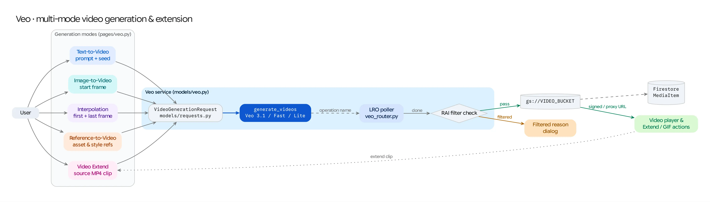

The **Veo** workspace (`/veo`) is GenMedia Creative Studio's flagship video synthesis environment. It exposes all capabilities of the Vertex AI Veo model family (`veo-2.0`, `veo-3.0`, and `veo-3.1`) through a capability-driven UI backed by asynchronous Long-Running Operation (LRO) polling and an async FastAPI router.

## Source Architecture

| Layer | File Path | Responsibility |
| :--- | :--- | :--- |
| **Mesop Page & State** | `pages/veo.py`, `state/veo_state.py` (`PageState`) | Multi-mode UI workspace, reference image/video uploaders, camera & cinematography controls, and video player gallery. |
| **UI Components** | `components/veo/generation_controls.py`, `components/veo/file_uploader.py`, `components/veo/video_display.py` | Modular mode switchers, dynamic parameter selectors bound to `config/veo_models.py`, and C2PA provenance viewer. |
| **Model Adapter** | `models/veo.py` (`generate_video`, `VideoGenerationRequest`) | Dispatches `client.models.generate_videos()`, polls LRO completion, stores local byte responses to GCS when needed, and extracts C2PA manifests. |
| **Async FastAPI Router** | `routers/veo_router.py` (`/api/veo/generate_async`, `/api/veo/TaskStatus/{task_id}`) | Non-blocking background task execution for long-running video generations. |
| **Model Registry** | `config/veo_models.py` (`VEO_MODELS`, `VeoModelConfig`) | Declarative capability registry defining supported modes, aspect ratios, durations, resolutions, audio support, and per-mode overrides for every Veo model. |

## Supported Generation Modes

The workspace adapts its upload slots and parameter constraints dynamically based on the active mode (`supported_modes` in `config/veo_models.py`):

1. **Text-to-Video (`t2v`):** Synthesizes video directly from a descriptive text prompt, negative prompt, and camera direction.
2. **Image-to-Video (`i2v`):** Animates a single starting reference frame (`reference_image_gcs`) into a full video clip while preserving the subject and composition.
3. **First & Last Frame Interpolation (`interpolation`):** Accepts both a starting frame (`reference_image_gcs`) and an ending target frame (`last_reference_image_gcs`), synthesizing a smooth cinematic transition between the two keyframes (`GenerateVideosConfig.last_frame`).
4. **Reference-to-Video (`r2v`):** Accepts up to **3 character/subject `ASSET` reference images** (`r2v_reference_images`) and/or a **`STYLE` reference image** (`r2v_style_image`) via `VideoGenerationReferenceImage`, maintaining character identity or visual aesthetic across newly generated scenes.
5. **Video Extension (`extend`):** Extends an existing Veo video (`video_input_gcs`) by an additional `7s` segment using `veo-3.1-generate-001` or `veo-3.1-fast-generate-001`.

## Model Matrix (`config/veo_models.py`)

| Version ID | Model Name | Supported Modes | Resolutions | Durations | Native Audio |
| :--- | :--- | :--- | :--- | :--- | :--- |
| **`3.1`** (Default) | `veo-3.1-generate-001` | `t2v`, `i2v`, `interpolation`, `r2v` (`ASSET`), `extend` | `720p`, `1080p`, `4k` | `4s`, `6s`, `8s` (`7s` on `extend`) | Yes |
| **`3.1-fast`** | `veo-3.1-fast-generate-001` | `t2v`, `i2v`, `interpolation`, `r2v` (`ASSET`), `extend` | `720p`, `1080p`, `4k` | `4s`, `6s`, `8s` (`7s` on `extend`) | Yes |
| **`3.1-lite`** | `veo-3.1-lite-generate-001` | `t2v`, `i2v`, `interpolation` | `720p`, `1080p` | `4s`, `6s`, `8s` | Yes |
| **`3.0`** / **`3.0-fast`** | `veo-3.0-generate-001`, `veo-3.0-fast-generate-001` | `t2v`, `i2v`, `interpolation` | `720p`, `1080p` | `4s`, `6s`, `8s` | Yes |
| **`2.0`** / **`2.0-exp`** | `veo-2.0-generate-001`, `veo-2.0-generate-exp` | `t2v`, `i2v`, `interpolation`, `r2v` (`ASSET` & `STYLE` on `2.0-exp`) | `720p` | `5s`–`8s` | No |

## Generation & LRO Polling Lifecycle

1. **Request Validation (`VideoGenerationRequest`):** Validates prompt presence, resolution (`720p`/`1080p`/`4k`), aspect ratio (`16:9` or `9:16`), video count (`1`–`4`), `person_generation` policy, deterministic `seed`, and optional `enhance_prompt` / `generate_audio` flags against the selected `VeoModelConfig`.
2. **Vertex AI LRO Submission:** `models/veo.py` constructs a `types.GenerateVideosConfig` with `output_gcs_uri=cfg.VIDEO_BUCKET` and invokes `client.models.generate_videos(model=..., prompt=..., image=..., video=..., config=...)`.
3. **Polling Loop:** The adapter polls `client.operations.get(operation)` every 10 seconds until `operation.done` is `True`.
4. **Post-Processing & Provenance:**
   * If the API returns inline `video_bytes` instead of a `gs://` URI, `models/veo.py` uploads the MP4 bytes directly to `cfg.VIDEO_BUCKET`.
   * **C2PA Content Credentials:** When present in the generated MP4 container, C2PA manifest data is extracted via `common/c2pa_utils.py` and attached to the Firestore `MediaItem` (`c2pa_manifest`) for cryptographic provenance inspection in the UI.
