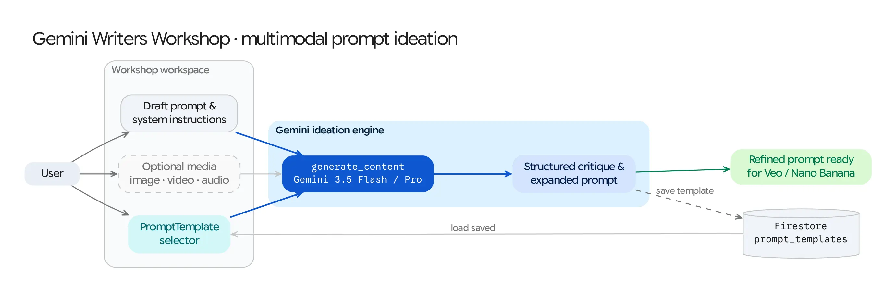

The **Gemini Writers Workshop** (`/gemini-writers-workshop`) is a multimodal ideation and prompt-engineering workbench. Creators can attach reference images, videos, or audio files alongside draft instructions, apply custom system personas, and save reusable **`PromptTemplate`** records to Firestore for use across the Studio.

## Source Architecture

| Layer | File Path | Responsibility |
| :--- | :--- | :--- |
| **Mesop Page & State** | `pages/gemini_writers_workshop.py` (`WritersWorkshopState`) | Prompt editor, system instruction panel, multimodal reference uploader, markdown output viewer, and template save/load dialogs. |
| **Template Service** | `common/prompt_template_service.py` (`PromptTemplate`, `PromptTemplateService`) | CRUD persistence layer storing categorized prompt templates in the Firestore `prompt_templates` collection. |
| **Model Config** | `config/default.py` (`MODEL_ID`) | Configures the default Gemini reasoning model (`gemini-2.5-flash` / `gemini-3.5-flash`). |

## Key Capabilities

### 1. Multimodal Context Grounding
* Users can upload or select from the Studio Library any combination of **images**, **videos**, or **audio files** (`media_gcs_uri`).
* The workshop attaches the media as a `types.Part.from_uri(file_uri=..., mime_type=...)` alongside the text prompt so Gemini can analyze visual composition, transcribe/critique audio, or write detailed shot-by-shot Veo/Nano Banana prompts grounded in the reference asset.

### 2. Custom System Instructions
* Users can customize the `system_instruction` passed into `types.GenerateContentConfig` to adopt specialized creative personas (e.g., *Commercial Director*, *Fashion Copywriter*, *Cinematographer*, or *Technical Prompt Engineer*).

### 3. Persistent `PromptTemplate` Library (`common/prompt_template_service.py`)
* Any refined prompt and system instruction pair can be saved to Firestore (`prompt_templates` collection) via `PromptTemplateService` with metadata including `label`, `key`, `category`, `prompt_text`, and `attribution` (`user_email`).
* Saved templates appear directly in the workshop's template selector for one-click reuse across sessions.
