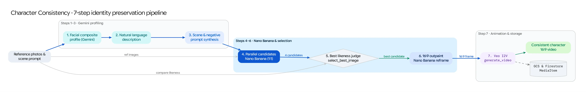

The **Character Consistency** workflow (`/character_consistency`) solves one of the hardest challenges in generative media: placing a specific person or character from reference photos into brand-new cinematic scenes and videos while preserving their exact facial structure and likeness.

## Source Architecture

| Layer | File Path | Responsibility |
| :--- | :--- | :--- |
| **Mesop Page & State** | `pages/character_consistency.py`, `state/character_consistency_state.py` | Multi-photo character uploader, scene prompt input, live step-by-step progress visualizer, candidate gallery, and video showcase. |
| **Workflow Engine** | `models/character_consistency.py` (`generate_character_video`, `FacialCompositeProfile`, `BestImage`) | Implements the 7-step generator pipeline combining Gemini structured analysis, Imagen 3 Subject Customization / Nano Banana, Gemini visual selection, 16:9 outpainting, and Veo video generation. |

## The 7-Step Pipeline (`models/character_consistency.py`)

### Step 1: Reference Photo Upload to GCS
* The user uploads one or more reference photographs of the target character (`character_images`) and provides a natural-language **Scene Prompt** describing the desired setting, lighting, and action.

### Step 2: Gemini Facial Composite Profile Extraction (`FacialCompositeProfile`)
* `extract_facial_profile()` sends all reference photos to **Gemini** with `response_schema=FacialCompositeProfile`, extracting a forensic-grade structured description covering `age`, `gender`, `ethnicity`, `hair_color`, `hair_style`, `eye_color`, `eye_shape`, `eyebrows`, `nose_shape`, `mouth_shape`, `chin_shape`, `jawline`, `face_shape`, `facial_hair`, `skin_tone`, `skin_texture`, `distinctive_features`, and `Typical_expression`.

### Step 3: Natural-Language Description Synthesis
* `natural_language_description()` converts the structured `FacialCompositeProfile` JSON into a cohesive photographic character description optimized for image generation conditioning.

### Step 4: Prompt Combination & Multi-Candidate Scene Generation
* `generate_scene_prompt()` merges the character description with the user's target **Scene Prompt**.
* `generate_images()` invokes Vertex AI subject-conditioned image synthesis (`imagen-3.0-capability-001` with `SubjectReferenceImage` and `ControlReferenceImage` face-mesh conditioning, or Nano Banana) to generate **4 candidate scene images** (`1:1` square framing focused on character likeness).

### Step 5: Gemini Best-Likeness Selection (`select_best_image`)
* `select_best_image()` passes the original reference photos, the generated candidate images, and the scene prompt to **Gemini** (`response_schema=BestImage`).
* Gemini compares facial geometry, expression, and scene fidelity across all candidates and selects `best_image_path` along with a detailed `reasoning` explanation displayed in the UI.

### Step 6: `16:9` Cinematic Outpainting (`outpaint_image`)
* To prepare the selected `1:1` portrait for widescreen video without cropping or distorting the character's face, `outpaint_image()` pads the selected image to a `16:9` canvas (`1920x1080`), generates a binary expansion mask, and outpaints the surrounding environment seamlessly.

### Step 7: Veo Video Synthesis (`generate_video`)
* Gemini generates a camera and motion prompt (`generate_video_prompt()`) tailored to the outpainted `16:9` keyframe, and `generate_video()` animates the frame via **Veo** (`models/veo.py`), logging all intermediate candidates, the outpainted frame, reasoning trace, and final MP4 as a `MediaItem` in Firestore.
