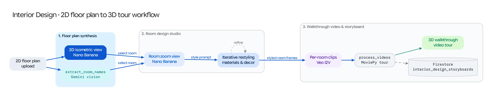

The **Interior Design** workflow (`/interior_design`) turns a flat 2D architectural floor plan into an interactive 3D interior design studio and guided video tour. It chains **Nano Banana (`gemini-2.5-flash-image` / `gemini-3.1-flash-image-preview`)**, **Gemini spatial room extraction**, **conversational room restyling**, and **Veo 3.1 + MoviePy tour assembly**.

## Source Architecture

| Layer | File Path | Responsibility |
| :--- | :--- | :--- |
| **Mesop Page & State** | `pages/interior_design_v2.py`, `state/interior_design_v2_state.py` (`PageState`) | Floor plan uploader, 3D view & room storyboarder, interactive Design Studio drawer, per-room Veo video generator, and final tour compiler. |
| **UI Components** | `components/interior_design/` (`floor_plan_uploader.py`, `room_View.py`, `design_studio.py`, `tour_video.py`) | Modular UI panels for each stage of the architectural pipeline. |
| **Models Used** | `models/gemini.py`, `models/veo.py`, `models/video_processing.py` | Multimodal image synthesis, room name extraction (`extract_room_names_from_image`), Veo I2V animation, and MoviePy concatenation. |

## Step-by-Step Pipeline

### Step 1: 2D Floor Plan to 3D Isometric Render & Room Identification
1. The user uploads a **2D Floor Plan** image (or chooses a preset floor plan) and enters an optional overall architectural style prompt (e.g., *Japandi minimalist with warm oak and linen*).
2. **3D Isometric Synthesis:** `pages/interior_design_v2.py` calls Nano Banana (`generate_image_from_prompt_and_images`) conditioned on the 2D floor plan to synthesize a full-color **3D Isometric Cutaway Render** of the entire home (`storyboard_item.styled_3d_view`).
3. **Gemini Room Extraction (`extract_room_names_from_image`):** In parallel, Gemini inspects the floor plan labels and layout to return a structured list of detected rooms (e.g., *Living Room*, *Kitchen*, *Primary Bedroom*, *Bathroom*).

### Step 2: Room Zoom-In & Conversational Design Studio
* Clicking any detected room button triggers **Zoom In (`on_zoom_in`)**, which passes both the original 2D floor plan and the 3D isometric render to Nano Banana with instructions to synthesize a photorealistic **first-person eye-level interior photograph** (`16:9`) of that specific room while preserving the exact furniture placement from the 3D view.
* **Interactive Design Studio (`on_design_room`):** Once a room view is generated, users can enter modification prompts (e.g., *"Replace the sofa with cognac leather and add pendant lighting over the island"*) and attach reference furniture/material swatch images to iteratively restyle the room (`styled_image_uri`).

### Step 3: Veo Room Walkthroughs & Full-Home Tour Assembly
* **Single-Room Video (`on_generate_video`):** Generates an `8s` **Veo 3.1** camera walkthrough clip (`video_uri`) for any styled room.
* **Full-Home Guided Tour (`on_generate_full_tour`):** Iterates through all styled rooms, generates Veo walkthrough clips for any room that does not yet have one, and stitches all room clips together via `process_and_concatenate_videos()` (`models/video_processing.py`) into a seamless master property tour (`final_video_uri`).
