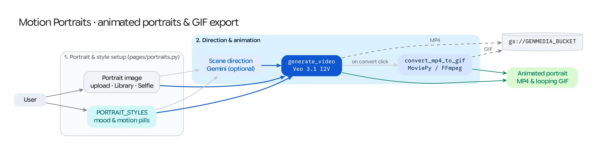

The **Motion Portraits** workflow (`/motion_portraits`) brings still character portraits, headshots, or live webcam selfies to life as living portraits—outputting both high-definition **Veo MP4 clips** and shareable **animated GIFs**.

## Source Architecture

| Layer | File Path | Responsibility |
| :--- | :--- | :--- |
| **Mesop Page & State** | `pages/portraits.py` (`PageState`, `create_scene_direction`) | Portrait uploader, live `selfie_camera` integration, style modifier chip selector (`PORTRAIT_STYLES`), Veo model/duration controls, and MP4 + GIF side-by-side output viewer. |
| **Webcam WebComponent** | `components/selfie_camera/selfie_camera.py` | Custom Lit WebComponent capturing a live browser webcam frame and uploading it directly to Cloud Storage. |
| **Models & Conversion** | `models/veo.py`, `models/video_processing.py` (`convert_mp4_to_gif`) | Runs Veo Image-to-Video (`i2v`) and converts the resulting MP4 clip into an optimized looping GIF via MoviePy. |

## Step-by-Step Pipeline

### Step 1: Portrait Acquisition (3 Sources)
Users can provide the base portrait (`reference_image_gcs`) via:
1. **Upload Image:** Upload any portrait photograph or digital illustration.
2. **Choose from Library:** Pick an existing portrait generated in Nano Banana or Virtual Try-On.
3. **Take a Selfie (`selfie_camera`):** Open the live browser camera dialog, capture a frame, and automatically store it to `gs://<GENMEDIA_BUCKET>`.

### Step 2: Style Modifiers (`PORTRAIT_STYLES`) & Gemini Scene Direction
* Users can select one or more curated motion & lighting modifiers defined in `config/default.py` (`PORTRAIT_STYLES`, such as subtle head turns, wind in hair, cinematic lighting shifts, or emotional expressions) and/or write custom motion direction.
* **AI Scene Direction (`create_scene_direction`):** When the user leaves custom direction open or requests scene expansion, **Gemini** inspects the uploaded portrait image (`types.Part.from_uri`) alongside the selected style modifiers and writes a natural, physically plausible camera-and-subject motion prompt that avoids distorting the subject's face.

### Step 3: Veo Image-to-Video Synthesis & Automatic GIF Conversion
1. **Veo `i2v` Generation:** Submits `VideoGenerationRequest` to `models/veo.py` with the portrait as `reference_image_gcs` and the expanded motion prompt.
2. **MP4-to-GIF Conversion (`convert_mp4_to_gif`):** Once the Veo MP4 completes, `models/video_processing.py` automatically downloads the clip, renders a looping animated GIF (`10 fps`) via MoviePy, uploads the GIF to Cloud Storage (`gif_url`), and records both assets in the Firestore `MediaItem`.
