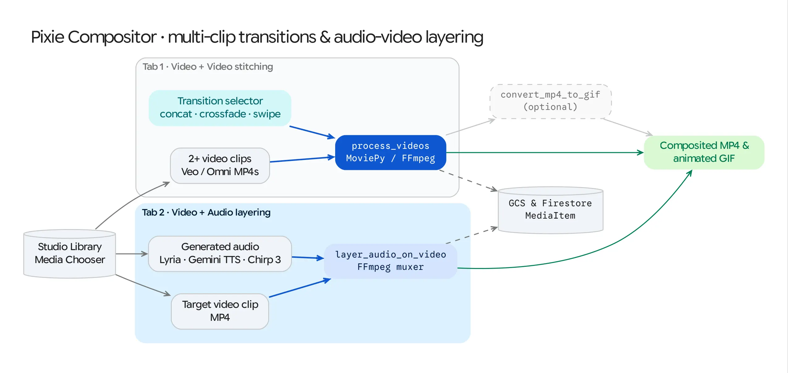

The **Pixie Compositor** (`/pixie_compositor`) is GenMedia Creative Studio's post-production editing suite. It allows creators to take video clips generated in **Veo** and audio tracks generated in **Lyria**, **Gemini TTS**, or **Chirp 3 HD** and assemble them into finished multi-shot sequences with transitions, layered soundtracks, and animated GIF exports.

## Source Architecture

| Layer | File Path | Responsibility |
| :--- | :--- | :--- |
| **Mesop Page & State** | `pages/pixie_compositor.py` (`PixieCompositorState`) | Two-tab workspace (*Video + Video Concatenation* and *Video + Audio Layering*), Firestore Library media pickers, transition selector, and GIF converter. |
| **Video Processing Engine** | `models/video_processing.py` (`process_and_concatenate_videos`, `layer_audio_on_video`, `convert_mp4_to_gif`) | MoviePy pipeline executing clip concatenation, crossfade/wipe transitions, audio track muxing, and GCS persistence. |

## Core Editing Workflows

### Tab 1: Multi-Video Concatenation & Transitions (`process_and_concatenate_videos`)
1. **Clip Selection:** Select 2 or more video clips from the Studio Library (queried from Firestore `genmedia_library` where `mime_type == "video/mp4"`).
2. **Transition Effect Selection (`selected_transition`):**
   * **Concatenate (`concat`):** Hard cut sequence (`concatenate_videoclips(clips, method="compose")`).
   * **Crossfade (`crossfade`):** Applies a `1.0s` `crossfadein` overlap between consecutive clips.
   * **Wipe (`wipe`):** Applies a directional slide transition (`CompositeVideoClip` with horizontal position animation) between clips.
3. **Render & Persist:** MoviePy exports the stitched master clip (`libx264`, `aac`, `24 fps`), uploads it to `gs://<GENMEDIA_BUCKET>/concatenated_videos/`, and logs a new `MediaItem` (`media_type="pixie_compositor"`).

### Tab 2: Video + Audio Track Layering (`layer_audio_on_video`)
1. **Asset Selection:** Pick a target **Video Clip** (`video_to_layer_uri`) and an **Audio Track** (`audio_to_layer_uri`, such as a 30-second Lyria score or a Gemini TTS voiceover) from the Studio Library.
2. **Audio Muxing:** `layer_audio_on_video()` loads both assets into MoviePy (`VideoFileClip` and `AudioFileClip`), trims the audio to match the video duration if the audio track is longer (`audio_clip.subclip(0, video_clip.duration)`), binds the audio via `video_clip.set_audio(audio_clip)`, and writes the combined MP4 to Cloud Storage.

### One-Click MP4-to-GIF Export (`convert_mp4_to_gif`)
* Both tabs include a **Convert to GIF** button on the rendered output video that invokes `convert_mp4_to_gif()` (`10 fps`) and saves the resulting `.gif` to Cloud Storage for easy embedding in presentations or chat spaces.
