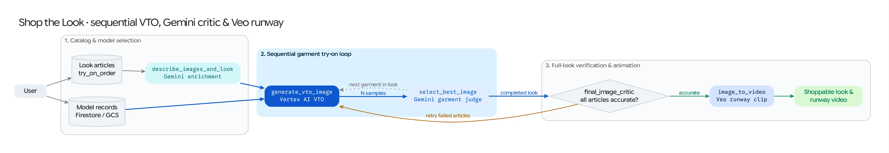

**Shop the Look** (`/shop_the_look`) is an agentic retail merchandising workflow that dresses a fashion model in a complete multi-piece outfit (tops, bottoms, outerwear, footwear, and accessories), verifies garment accuracy after every step using a **Gemini visual critic**, automatically retries inaccurate garments, and produces a **Veo runway video**.

## Source Architecture

| Layer | File Path | Responsibility |
| :--- | :--- | :--- |
| **Mesop Page & UI** | `pages/shop_the_look.py`, `components/shop_the_look/` | Interactive catalog & model selector, CSV catalog uploader, progress stepper, step-by-step VTO progression viewer, and final look showcase. |
| **Workflow Handlers** | `models/shop_the_look_handlers.py` (`on_click_generate_look`, `vto_Progression`, `on_click_veo`) | Orchestrates the sequential try-on loop, critic retry cycle, and Veo runway generation. |
| **Models & Critic Logic** | `models/shop_the_look_workflow.py`, `models/shop_the_look_models.py` (`CatalogRecord`, `ModelRecord`, `Critic`, `FinalCritic`) | Firestore catalog hydration, Gemini garment description & ordering, Vertex AI VTO calls (`virtual-try-on-001`), `select_best_image`, and `final_image_critic`. |

## Step-by-Step Pipeline

### Step 1: Model & Multi-Article Catalog Selection
* Users select a human or virtual fashion model (`ModelRecord`) and choose multiple apparel articles (`CatalogRecord` items: e.g., shirt, trousers, jacket, shoes) from the Firestore-backed catalog (`shop_the_look_models` and `shop_the_look_catalog`), or upload their own CSV/images.

### Step 2: Gemini Garment Enrichment & Try-On Ordering (`describe_images_and_look`)
* Before calling Virtual Try-On, `describe_images_and_look()` sends all selected garment images to **Gemini** in parallel.
* Gemini classifies each article's `clothing_type`, generates a detailed visual description (`ai_description`), and assigns a logical dressing order (`try_on_order`: inner layers and tops/bottoms first, outerwear and shoes last).

### Step 3: Sequential Garment Try-On Loop + Gemini Best-Sample Judge
For each garment in `try_on_order`:
1. **Parallel VTO Sampling (`generate_vto_image`):** Invokes Vertex AI Virtual Try-On (`virtual-try-on-001`) using the current model image (`current_model_image`) and the target garment image (`item.item_image`), generating $N$ candidate try-on samples (`sample_count`, default `3`).
2. **Gemini Garment Judge (`select_best_image`):** Sends the original garment image and all $N$ VTO candidates to Gemini with `response_schema=Critic`. Gemini evaluates pattern fidelity, fit, and artifact absence, returning the index (`best_image`) of the most faithful sample, which becomes `current_model_image` for the next garment in the sequence.

### Step 4: Full-Look Critic Verification & Automated Retry (`final_image_critic`)
Once all garments have been applied sequentially:
1. `final_image_critic()` sends the completed look image alongside **all** original catalog article images to Gemini (`response_schema=FinalCritic`).
2. Gemini inspects whether every article is present and accurately rendered (`accurate: bool`) and returns `retry_list: list[int]` for any garment that was occluded, distorted, or dropped during subsequent try-on steps.
3. **Self-Healing Retry Loop:** If `accurate` is `False` (and `retry_counter < max_retry`), the workflow automatically re-runs the VTO + judge loop for only the failed articles in `retry_list` and re-verifies with `final_image_critic`.

### Step 5: Veo Runway Video Synthesis
* From the verified final look (or automatically when **Generate Video** is enabled), `image_to_video()` submits the styled model image to **Veo** (`veo-3.1-generate-001`) with a tailored runway & lookbook motion prompt, rendering a `9:16` or `16:9` shoppable video clip stored in Cloud Storage and Firestore.
