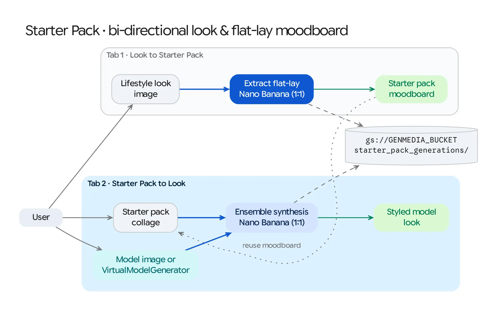

The **Starter Pack** workflow (`/starter-pack`) is a bi-directional fashion and retail merchandising tool powered by **Nano Banana (`gemini-2.5-flash-image` / `gemini-3.1-flash-image-preview`)** and **`VirtualModelGenerator`**. It converts between full-body lifestyle outfit photos and curated "Starter Pack" flat-lay product collages.

## Source Architecture

| Layer | File Path | Responsibility |
| :--- | :--- | :--- |
| **Mesop Page & State** | `pages/starter_pack.py`, `state/starter_pack_state.py` (`StarterPackState`) | Two-tab workspace (*Look to Starter Pack* and *Starter Pack to Look*), image uploaders, virtual model generator button, and cross-tab asset transfer. |
| **Workflow Model Adapter** | `models/starter_pack.py` (`generate_starter_pack_from_look`, `generate_look_from_starter_pack`, `generate_virtual_model`) | Executes `1:1` Nano Banana multimodal image synthesis with retail product extraction and ensemble dressing prompts. |

## Bi-Directional Tabs

### Tab 1: Look → Starter Pack (`generate_starter_pack_from_look`)
* **Input:** A full-body lifestyle photograph, street-style look, or runway image (`look_image_uri`).
* **Process:** Invokes Nano Banana (`aspect_ratio="1:1"`) with a specialized retail extraction prompt (`config/prompts.yaml` → `generate_starter_pack_from_look`) that isolates every wearable garment and accessory from the outfit (outerwear, top, trousers/skirt, footwear, bag, eyewear, watch/jewelry) and arranges them into a clean, labeled studio flat-lay **"Starter Pack" moodboard collage**.
* **Output:** Stored in `gs://<GENMEDIA_BUCKET>/starter_pack_generations/` and immediately available to send into Tab 2.

### Tab 2: Starter Pack → Look (`generate_look_from_starter_pack`)
* **Inputs:**
  1. A **Starter Pack / Flat-Lay Collage** image (`starter_pack_image_uri`) uploaded by the user or generated in Tab 1.
  2. A **Target Model Image** (`model_image_uri`) uploaded from disk, chosen from the Library, or synthesized on the fly via **Generate Virtual Model** (`VirtualModelGenerator`).
* **Process:** Passes both the Starter Pack collage and the model portrait to Nano Banana (`generate_image_from_prompt_and_images`) so the model is dressed in the complete ensemble of garments and accessories depicted in the collage while preserving the model's identity and studio lighting.
