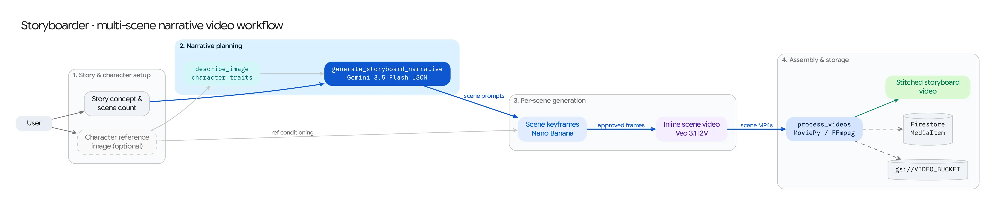

The **Storyboarder** workflow (`/storyboarder`) transforms a single story premise and optional character reference photo into a multi-scene short film. It chains **Gemini structured narrative planning**, **Nano Banana sequential keyframe generation**, **Veo Image-to-Video (I2V) animation**, and **MoviePy timeline assembly**.



## Source Architecture

| Layer | File Path | Responsibility |
| :--- | :--- | :--- |
| **Mesop Page & Orchestrator** | `pages/storyboarder.py` (`PageState`, `NarrativeStructure`, `SceneDetail`) | End-to-end 4-stage pipeline UI, per-scene prompt & keyframe editor, individual scene regeneration, Veo video loop, and final MoviePy compilation. |
| **Image Synthesis** | `models/gemini.py` (`generate_image_from_prompt_and_images`) | Synthesizes 16:9 scene keyframes conditioned on the character asset and previous scene frames. |
| **Video Synthesis** | `models/veo.py` (`generate_video`, `VideoGenerationRequest`) | Animates each scene keyframe into an `8s` HD video clip with native audio. |
| **Video Assembly** | `models/video_processing.py` (`process_and_concatenate_videos`) | Concatenates all scene clips into a single master MP4 and uploads it to Cloud Storage. |

## Step-by-Step Pipeline

### Step 1: Story Concept & Structured Script Generation (`NarrativeStructure`)
1. The user enters a **Story Concept** (or clicks **Random Prompt** to have Gemini invent one), selects a visual style (e.g., *Cinematic*, *Anime*, *Claymation*, *Noir*) and aspect ratio (`16:9` or `9:16`), and optionally uploads or selects a **Character Reference Image**.
2. `pages/storyboarder.py` calls `client.models.generate_content()` with `response_schema=NarrativeStructure`:
   ```python
   class SceneDetail(BaseModel):
       title: str
       image_prompt: str
       video_prompt: str

   class NarrativeStructure(BaseModel):
       overall_style: str
       scenes: list[SceneDetail]
   ```
3. Gemini outputs a 3-to-5 scene breakdown where each scene has both a static composition prompt (`image_prompt`) and a camera/motion prompt (`video_prompt`).

### Step 2: Sequential Character-Aware Keyframe Synthesis
To maintain visual continuity from scene to scene, Storyboarder generates keyframes sequentially using **Nano Banana** (`gemini-2.5-flash-image` / `gemini-3.1-flash-image-preview`):
* **Scene 1:** Conditioned on `scene[0].image_prompt` + the user's `character_image_gcs` (if provided).
* **Scene $k$ ($k > 1$):** Conditioned on `scene[k].image_prompt` + `character_image_gcs` + the generated keyframe from Scene $k-1$ (`previous_scene_image`) so lighting, environment, and character wardrobe carry forward.
* Users can inspect the storyboard grid, edit any individual `image_prompt`, and click **Regenerate Image** on any single scene before proceeding to video generation.

### Step 3: Scene-by-Scene Veo Animation
* Clicking **Generate Videos for All Scenes** iterates through every storyboard card and submits an Image-to-Video (`i2v`) `VideoGenerationRequest` to **Veo** (`veo-3.1-fast-generate-001` or `veo-3.1-generate-001`) using the scene's keyframe (`reference_image_gcs`) and `video_prompt`.
* Users can also regenerate any individual scene's video clip independently if they tweak its `video_prompt`.

### Step 4: MoviePy Master Video Assembly
* Once all scenes have rendered their Veo video clips, clicking **Create Final Movie** downloads the scene MP4s from GCS, concatenates them in sequence via `models/video_processing.py`, uploads the stitched master film to `gs://<GENMEDIA_BUCKET>/storyboarder_movies/`, and logs a complete `MediaItem` in Firestore.
