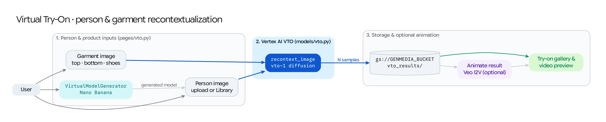

The **Virtual Try-On (VTO)** workflow (`/vto`) provides a dedicated studio for Vertex AI's specialized Virtual Try-On model (`virtual-try-on-001` via `client.models.recontext_image`), paired with a synthetic **Virtual Model Generator** (`VirtualModelGenerator`) and one-click **Veo** video animation.

## Source Architecture

| Layer | File Path | Responsibility |
| :--- | :--- | :--- |
| **Mesop Page & State** | `pages/vto.py` (`PageState`) | Person & garment uploaders, synthetic model generator trigger, sample count & seed controls, result gallery, and inline Veo animation. |
| **VTO Model Adapter** | `models/vto.py` (`generate_vto_image`, `call_virtual_try_on`) | Wraps `client.models.recontext_image()` (`virtual-try-on-001`) and the GAPIC `PredictionServiceClient` helper for fitting product images onto a person image. |
| **Synthetic Model Generator** | `models/virtual_model_generator.py` (`VirtualModelGenerator`, `DEFAULT_PROMPT`) | Generates diverse, studio-lit full-body fashion model portraits (`imagen-3.0-generate-002` / Nano Banana) using randomized gender, silhouette, and pose attributes from `config/virtual_model_options.json`. |

## Step-by-Step Pipeline

### Step 1: Person Image Selection or Synthetic Model Generation
Users can provide the target person portrait (`person_image_gcs`) in three ways:
1. **Upload / Library Selection:** Upload a full-body or half-body portrait or pick an existing model from the Studio Library.
2. **Generate Virtual Model (`on_generate_person_image`):** Click **Generate Virtual Model** to invoke `VirtualModelGenerator`, which samples a randomized combination of gender presentation, body silhouette, and camera framing from `config/virtual_model_options.json` and synthesizes a clean studio portrait ready for apparel fitting.

### Step 2: Product Garment Selection
* Upload or select a product garment image (`product_image_gcs`)—such as a top, dress, jacket, or bottom—on a flat lay, mannequin, or model.

### Step 3: Vertex AI VTO Synthesis (`models.recontext_image`)
* `generate_vto_image()` calls `client.models.recontext_image()` with `model=cfg.VTO_MODEL_ID` (`virtual-try-on-001`), passing:
  * `source=types.RecontextImageSource(person_image=..., product_images=[types.ProductImage(product_image=...)])`
  * `config=types.RecontextImageConfig(number_of_images=sample_count, base_steps=base_steps, safety_filter_level=..., person_generation=...)`
* Each generated try-on image is uploaded to `gs://<GENMEDIA_BUCKET>/vto_result_images/` and logged to Firestore (`MediaItem` with `media_type="vto"`).

### Step 4: Optional Inline Veo Video Animation (`on_animate_click`)
* Every synthesized VTO result card includes an **Animate with Veo** button. Clicking it submits the try-on result directly to `models/veo.py` (`veo-3.1-fast-generate-001`, `9:16` portrait aspect ratio) to render a natural fashion movement clip (`result_videos` on the same card).
